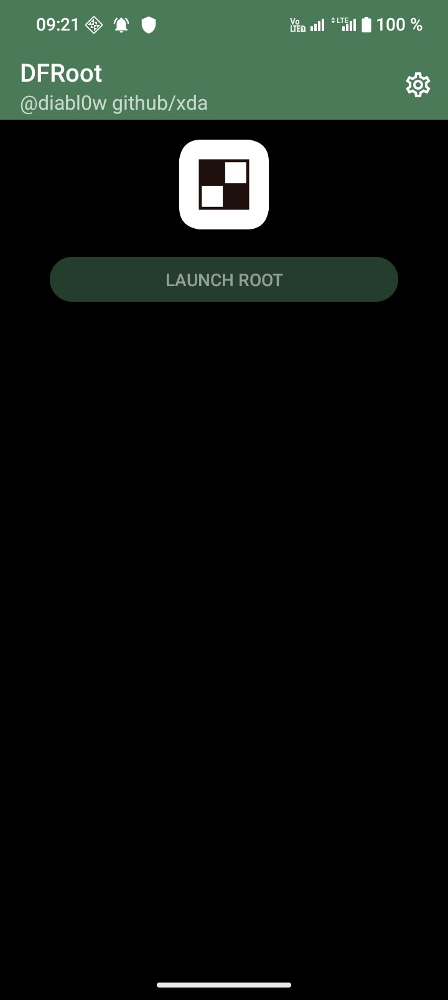
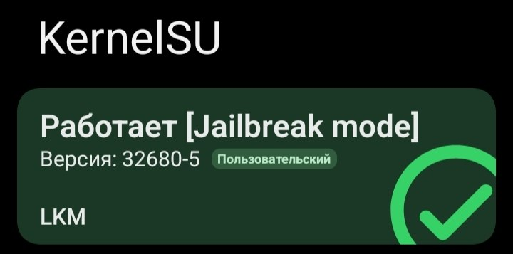

> [!WARNING]
> **Данный репозиторий содержит версии 2.0+. \
> Если вам нужна более ранняя версия, все старые версии \
> находятся в [старом репозитории](https://github.com/skytr1x/Obhod)**

# Obhod - обход блокировок для телефона

Требования:
- Android 11+
- Для стабильной работы в фоне разрешите приложению неограниченное использование батареи;
  автозапуск и названия настроек зависят от производителя телефона. \

Для Zapret Root:
- Android 11+
- KernelSU, KernelSU Next или совместимый root-менеджер с `ksud`.

---

### Obhod — приложение с двумя режимами обхода

VPN-режим собирает встроенный исходный код SOCKS5-движка [ByeDPI](https://github.com/hufrea/byedpi) в ревизии, используемой [ByeByeDPI](https://github.com/romanvht/ByeByeDPI), и проверяет его оригинальные CLI-стратегии на HTTPS-сайтах. Нативный движок находится в `core/src/byedpi`, JNI-адаптеры — в `core/src/jni`. Поток VPN передаётся в SOCKS через [hev-socks5-tunnel](https://github.com/heiher/hev-socks5-tunnel), который остаётся git submodule. Root-режим управляет KernelSU-модулем nZAPRET через `ksud`. Для Telegram используется Rust-реализация из [tg-ws-proxy-android](https://github.com/amurcanov/tg-ws-proxy-android) (архивировано).

Сторонние проекты сохраняют собственные лицензии и авторские права. Подробности и ссылки приведены выше и в разделе "Исходники" в приложении.

---

## Сборка проекта

Собрать приложение локально можно одной командой:
```bash
git clone --recurse-submodules https://github.com/heavenTreatment/Obhod
cd Obhod

# Нативная часть Телеграм-прокси собирается под все ABI приложения
rustup target add aarch64-linux-android armv7-linux-androideabi x86_64-linux-android

# Linux
./gradlew :app:assembleRelease # Для сборки релиз версии. Нужна подпись.
./gradlew :app:assembleDebug # Для сборки дебаг версии. Не нужна подпись.

# Windows - PowerShell
gradlew.bat :app:assembleDebug
gradlew.bat :app:assembleRelease
```

## Установка

**После сборки**
```bash
adb install -r app/build/outputs/apk/release/app-universal-release.apk # если релиз

adb install -r app/build/outputs/apk/debug/app-universal-debug.apk # если дебаг
```

Либо же просто установить готовый .apk файл из [релизов](https://github.com/heavenTreatment/Obhod/releases/latest)

---

## Как запустить Zapret Root с временным root-доступом?

При первом запуске приложение устанавливает модуль nZAPRET через `ksud`. После установки потребуется перезагрузить устройство.

> [!WARNING]
> **Не на всех устройствах может работать temporary root**

Для установки временных рут прав понадобятся:
- [KernelSU Next](https://github.com/KernelSU-Next/KernelSU-Next)
- [DFRoot](https://github.com/diabl0w/DFRoot)

После установки двух приложений устанавливаем сначала KernelSU Next, после него DFRoot. \
Заходим в DFRoot и выбираем KernelSU как рут менеджер.

После этого нажимаем LAUNCH ROOT



Когда вы успешно получите рут права, зайдите в KernelSU (либо зайдет автоматически после получения),
где вы должны увидеть следующее:



Если все так, следующей задачей будет зайти в Суперпользователи, найти там Obhod и выдать ему суперпользователя.

---

# Ресурсы проекта

У проекта есть только [Телеграм Канал](https://t.me/obhodDev).

Для поддержки / баг репортов / вопросов можно писать [лично мне](https://t.me/heavenTreat)

Вы также можете меня поддержать на [Donation Alerts](https://dalink.to/skytr1x).
